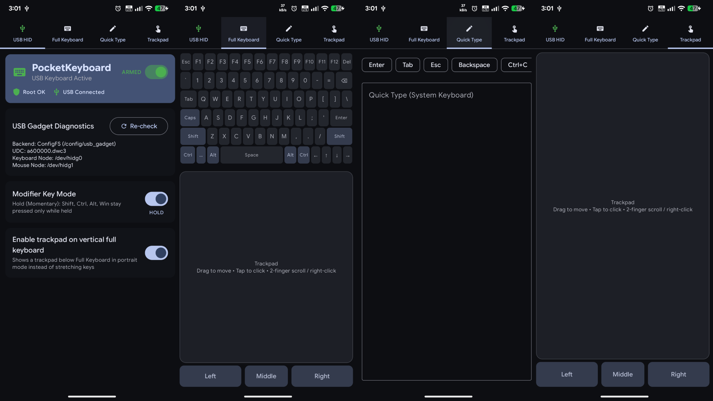

# PocketKeyboard


<p align="center">
  <b>Dual-Mode Wireless &amp; Wired Virtual Keyboard, Trackpad &amp; Gamepad for Android</b><br>
  <b>No-Root Bluetooth HID</b> + <b>No-Root USB Bridge (250 Hz)</b> + <b>Root USB Gadget HID</b> • Jetpack Compose &amp; Material You
</p>

---

## Overview

**PocketKeyboard** turns your Android smartphone into a virtual **Keyboard + 3-Button Mouse/Trackpad + Gamepad (Xbox / PS5)** across three transport modes:

1. **Bluetooth (No Root, Default on Android 9+):** Uses `BluetoothHidDevice` for wireless Keyboard + Trackpad + Gamepad (plus an automatic Bluetooth Direct RFCOMM Bridge for Windows). Works with **zero PC companion software** on Windows, macOS, Linux, ChromeOS, Android TV, and Steam Deck.
2. **USB Bridge (No Root, ~1–4 ms Wired):** Streams Gamepad, Trackpad, and Keyboard over a wired USB cable at **250 Hz (`4 ms`) with `0 ms` instant button wakeup** to [`pc-xbox-bridge/PocketPadXboxBridge.exe`](./pc-xbox-bridge/PocketPadXboxBridge.exe) — using either **USB Tethering (raw UDP, ~0.5–1.5 ms)** or **USB Debugging / ADB (`TCP_NODELAY`, ~2–4 ms, preserves PC Wi-Fi/ping)**.
3. **USB HID (Root):** Uses the Linux kernel's USB gadget driver (`ConfigFS`, `/dev/hidg*`, or legacy `android_usb`) over a USB data cable. Recognized natively by **UEFI/BIOS menus, bootloaders, recovery consoles, Linux, Windows, macOS, and ChromeOS**.

For Windows PC games that require an **XInput (Xbox 360) controller** — or for **no-root ~1–4 ms wired USB Keyboard + Mouse + Xbox 360** — run the included [`pc-xbox-bridge/PocketPadXboxBridge.exe`](./pc-xbox-bridge/PocketPadXboxBridge.exe) bridge (uses `ViGEmBus` + Win32 `SendInput`).

---

## Features

- **Material You Design**: Dynamic color theming that adapts to your wallpaper on Android 12+ (Material 3), with dark/light mode support.
- **5-Page Interface**:
  1. **Connect**: Switch between **Bluetooth**, **USB Bridge (No Root • Fast)**, and **USB Root (BIOS HID)**, manage Bluetooth discoverability and paired hosts, view local USB Tethering IPs, check root/USB gadget diagnostics (`ConfigFS` path, `UDC`, `/dev/hidg*` nodes), pick your **Controller Layout** (`Xbox` / `PS5`), and tune **Trackpad Sensitivity**.
  2. **Keyboard**: Complete 6-row physical keyboard (`Esc`, `F1`–`F12`, `Del`, numbers/symbols, QWERTY, `Caps`, `Enter`, `Shift`, `Ctrl`, `Win`, `Alt`, `Space`, Arrow keys).
     - In **landscape**, the keyboard fills the entire screen.
     - In **portrait**, keys keep a natural compact height with an optional **Trackpad** below (controlled by *"Enable trackpad on vertical full keyboard"*).
  3. **Quick**: Uses your Android system virtual keyboard (e.g., Gboard) for fast typing, swipe, and autocorrect—live-streaming keystrokes and deletions over HID, with quick chips (`Enter`, `Tab`, `Esc`, `Backspace`, `Ctrl+C`, `Ctrl+V`).
  4. **Trackpad**: Full-screen touch trackpad with adjustable **Trackpad Sensitivity** (`0.50x`–`2.50x`), adaptive pointer acceleration, lossless sub-pixel tracking, 2-finger-to-1-finger cursor jump protection, **Left / Middle / Right** physical mouse buttons (supports press-and-hold), 2-finger scroll wheel, 2-finger tap for right-click, 1-finger tap for left-click, and **double-tap & drag** (second tap holds Left Mouse Button until finger release).
  5. **Gamepad (`Xbox` / `PS5` styles)**: Multi-touch virtual controller with a 1-tap `XBOX ⇄ PS5` toggle, optional **FULL / TABS** fullscreen mode, ergonomic Xbox (outer-left thumbstick) vs PS5 DualSense layouts, **floating-origin dynamic thumbsticks** (`1.35` precision curve + smooth radial deadzone), relative-slide analog triggers, 8-way split D-Pad, Touchpad, and Mute.
- **Modifier Key Mode (Toggle vs Hold)**: Switch between **TOGGLE** (sticky tap-to-lock/unlock) and **HOLD** (momentary press-and-release with multi-touch support) for `Shift`, `Ctrl`, `Alt`, and `Win`.
- **Ultra-Low-Latency Streaming**:
  - **USB Bridge (No Root)** runs at **250 Hz (`4 ms`)** over USB Tethering (raw UDP) or ADB (`TCP_NODELAY`) with **0 ms instant wakeup** on button/D-pad/mouse-click transitions.
  - Bluetooth registers with low-latency HID QoS (`11.25ms` target latency, falling back cleanly if an OEM stack rejects QoS) and uses cached permission checks to avoid per-frame binder IPC.
  - Trackpad and Gamepad use dedicated `Thread.MAX_PRIORITY`, zero-allocation, monotonic-deadline coalescing workers (`4ms` over USB Bridge or direct USB Root, `14ms` `su` USB Root, `11ms` over Bluetooth) paired with non-blocking `GamepadCoalescer` (`timeBeginPeriod(1)`) on Windows so stale frames never pile up lag.

---

## Device & Requirements

### Bluetooth HID Mode (No Root)
| Requirement | Specification |
|---|---|
| **Root Access** | **Not required** (works on stock Android devices). |
| **Android Version** | Android 9.0 (Pie / API 28) or higher with Bluetooth HID Device profile support. |
| **Host Device** | Any OS with Bluetooth HID support (Windows, macOS, Linux, ChromeOS, Android TV, iOS/iPadOS, etc.). |

### USB HID Mode (Root)
| Requirement | Specification |
|---|---|
| **Root Access** | Magisk, KernelSU, or APatch (required to manage USB ConfigFS and write to `/dev/hidg*`). |
| **Android Version** | Android 8.0 (Oreo / API 26) or higher. |
| **Kernel Support** | Linux kernel with USB Gadget ConfigFS and HID function support (`CONFIG_USB_CONFIGFS_F_HID=y`), pre-exposed `/dev/hidg*`, or legacy `android_usb`. |
| **USB Cable** | USB data cable (charge-only cables will not enumerate). |

---

## Windows PC Xbox 360 Bridge (`pc-xbox-bridge`)

Most Windows PC games only listen to **XInput (Xbox controllers)** and ignore Generic DirectInput HID controllers. In addition, Windows aggressively caches Bluetooth HID descriptors from the first time you paired your phone (so if you paired before Gamepad was added, Windows only sees Keyboard + Mouse).

`pc-xbox-bridge/PocketPadXboxBridge.exe` solves both automatically with zero manual button mapping:
- **USB Tethering Bridge (No Root, ~0.5–1.5 ms Raw UDP):** Auto-discovers Android's USB RNDIS/NCM gateway and streams **Xbox 360 (ViGEmBus) + Mouse + Keyboard (`SendInput`)** at 250 Hz (`0 ms` button wakeup).
- **USB Cable via ADB Tunnel (No Root, ~2–4 ms `TCP_NODELAY`):** Automatically runs `adb forward tcp:27189 tcp:27189` and streams **Xbox 360 + Mouse + Keyboard** without affecting your PC's Wi-Fi or online game routing.
- **Bluetooth Direct Bridge (No Root RFCOMM):** Connects directly to PocketKeyboard over Bluetooth without needing to unpair/re-pair on Windows, bypassing stale Windows Bluetooth HID caches while Keyboard & Mouse continue working over Bluetooth HID.
- **USB Root & Bluetooth HID Passthrough:** Also attaches directly to PocketKeyboard's HID Gamepad endpoint when exposed over USB Root (`hidg2`) or freshly-paired Bluetooth HID (`Col03`).
- Mirrors controller state into **ViGEmBus** as a real **Xbox 360 (XInput) controller** (`0x045E` / `0x028E`).

> **Note on real PS5 consoles:** Actual PlayStation 5 consoles require Sony's hardware cryptographic authentication chip and reject emulated Bluetooth/USB controllers.

### Running the Bridge
1. Make sure the **ViGEmBus** driver (`Nefarius Virtual Gamepad Emulation Service`) is installed on your Windows PC.
2. Choose either **USB Bridge** mode on your phone (plug in USB with **USB Tethering** or **USB Debugging**) or **Bluetooth** mode, then double-click [`pc-xbox-bridge/PocketPadXboxBridge.exe`](./pc-xbox-bridge/PocketPadXboxBridge.exe).
3. Keep the bridge console window open while playing — it auto-selects the fastest active path (**USB Tethering UDP** → **USB ADB TCP** → **Native HID** → **Bluetooth Direct Bridge**), plugs in a virtual Xbox 360 controller, injects Mouse/Keyboard over USB Bridge, and handles disconnects cleanly.
4. Press `Ctrl+C` or close the window to unplug the virtual controller and release held keys cleanly.

### Bridge CLI Options
```powershell
# Verify ViGEmBus driver, v2 protocol parser, HID keymap & virtual Xbox 360 controller
.\pc-xbox-bridge\PocketPadXboxBridge.exe --test

# List USB Tethering IPs, ADB path, HID gamepads, BT candidates & stale BT cache diagnostics
.\pc-xbox-bridge\PocketPadXboxBridge.exe --list

# Optional: manually target a specific phone IP over USB Tethering / LAN UDP
.\pc-xbox-bridge\PocketPadXboxBridge.exe --udp 192.168.42.129
```

### Xbox / PS5 → XInput Mapping
| Xbox Label | PS5 Label | HID Usage | Xbox 360 (XInput) Target |
|---|---|---|---|
| `A` / `B` / `X` / `Y` | `✕` / `○` / `□` / `△` | Buttons `2` / `3` / `1` / `4` | `A` / `B` / `X` / `Y` |
| `LB` / `RB` | `L1` / `R1` | Buttons `5` / `6` | `Left Shoulder` / `Right Shoulder` |
| `LT` / `RT` | `L2` / `R2` | `Rx` / `Ry` (`0`–`255`) + Buttons `7` / `8` | `Left Trigger` / `Right Trigger` |
| `LS` / `RS` | `L3` / `R3` | Buttons `11` / `12` | `Left Thumb` / `Right Thumb` |
| `View` / `Touchpad` | `Create` / `Touchpad` | Buttons `9` / `14` | `Back` |
| `Menu` | `Options` | Button `10` | `Start` |
| `Xbox` | `PS` | Button `13` | `Guide` |
| D-Pad | D-Pad | Hat Switch (`0x39`) | `DPad Up / Down / Left / Right` |
| `L` / `R` Sticks | `L` / `R` Sticks | `X`, `Y`, `Z`, `Rz` (`0`–`255`) | `sThumbLX`, `sThumbLY`, `sThumbRX`, `sThumbRY` (`Y`/`Rz` inverted) |

### Rebuilding the Bridge (Optional, MSYS2 `g++`)
```powershell
g++ -O2 -std=c++17 -Wall -Wextra -static -static-libgcc -static-libstdc++ `
  pc-xbox-bridge/PocketPadXboxBridge.cpp `
  -o pc-xbox-bridge/PocketPadXboxBridge.exe `
  -lhid -lsetupapi -lws2_32 -lbthprops -liphlpapi -lwinmm
```

---

## Build Prerequisites (Android App)

- **JDK 17** *(Required)* — Android Gradle Plugin 8.3 and Kotlin 1.9.22 require Java 17 (newer JDKs such as Java 21+ or 25 are not supported by AGP 8.3).
- **Android SDK** — `compileSdk = 34`, `minSdk = 26`, `targetSdk = 34`, Build-Tools `34.0.0`.
- **Gradle 8.5** — Included via the Gradle Wrapper (`./gradlew` / `gradlew.bat`).

---

## How to Build (Android App)

### Option 1: Android Studio (Recommended)

1. Clone or open this project folder in Android Studio.
2. Android Studio will sync Gradle using its bundled JDK 17 (JBR) and generate `local.properties`.
3. Click **Build > Make Project** or run directly on your device.

### Option 2: Command Line (CLI)

1. Set `JAVA_HOME` to JDK 17:
   ```powershell
   # Windows PowerShell
   $env:JAVA_HOME = "C:\Program Files\Eclipse Adoptium\jdk-17.0.x"
   ```
   ```bash
   # Linux / macOS
   export JAVA_HOME=/path/to/jdk-17
   ```
2. Create `local.properties` in the project root pointing to your Android SDK:
   ```properties
   sdk.dir=C:/Users/<Username>/AppData/Local/Android/Sdk
   ```
3. Build the debug APK:
   ```bash
   # Windows
   .\gradlew.bat assembleDebug

   # Linux / macOS
   ./gradlew assembleDebug
   ```
4. Install onto a connected device:
   ```bash
   adb install -r app/build/outputs/apk/debug/app-debug.apk
   ```

---

## Project Architecture

```
PocketKeyboard/
├── app/src/main/java/com/pocketkeyboard/
│   ├── MainActivity.kt              # Edge-to-edge Compose host activity
│   ├── root/
│   │   └── RootShell.kt             # Superuser (su) command & batch executor
│   ├── hid/
│   │   ├── HidDescriptors.kt        # Shared USB & composite Bluetooth HID descriptors + HidGamepadMap
│   │   ├── HidKeyMap.kt             # USB HID Usage Tables 1.12 scan codes & modifier masks
│   │   ├── HidCharMapper.kt         # ASCII character to (modifier, keyCode) mapper for Quick Type
│   │   ├── BluetoothHidManager.kt   # API 28+ BluetoothHidDevice registration, QoS & host connections
│   │   ├── BluetoothGamepadBridgeServer.kt # No-root Bluetooth RFCOMM gamepad bridge for Windows
│   │   ├── UsbBridgeServer.kt       # No-root 500 Hz USB Tethering (UDP) + ADB (TCP) PocketBridge v2 server
│   │   ├── UsbGadgetManager.kt      # ConfigFS (/config/usb_gadget, /sys/kernel/config/usb_gadget, g1 fallback)
│   │   └── HidReportSender.kt       # Pluggable USB/Bluetooth keyboard, coalesced mouse & gamepad sender
│   ├── viewmodel/
│   │   └── KeyboardViewModel.kt     # Dual-mode state holder for Bluetooth/USB, modifiers, trackpad & gamepad
│   └── ui/
│       ├── theme/                   # Material You dynamic dark/light color schemes & typography
│       ├── components/
│       │   ├── KeyDef.kt            # Key model (weights, labels, HID codes, modifiers)
│       │   ├── KeyButton.kt         # Press/release key composable with haptic feedback
│       │   ├── KeyboardLayout.kt    # Full 6-row keyboard (fills screen in landscape, compact in portrait)
│       │   └── StatusCard.kt        # Connect tab: mode switch, hosts, sensitivity, layout & diagnostics
│       └── screens/
│           ├── MainScreen.kt        # 5-tab Material 3 scaffold, permissions/BT launchers & split layout
│           ├── QuickTypeScreen.kt   # System virtual keyboard (IME) live-streaming screen
│           ├── TrackpadScreen.kt    # Trackpad surface + Left/Middle/Right buttons
│           └── ControllerScreen.kt  # Multi-touch Xbox / PS5 virtual gamepad screen
└── pc-xbox-bridge/
    ├── PocketPadXboxBridge.cpp      # Native Windows HID -> ViGEmBus Xbox 360 (XInput) bridge
    └── PocketPadXboxBridge.exe      # Prebuilt standalone Windows bridge executable
```

---

## How It Works Under the Hood

### Bluetooth HID & Direct Gamepad Bridge (No Root)
1. **Profile Registration**: `BluetoothHidManager` binds `BluetoothProfile.HID_DEVICE` and registers a 203-byte composite SDP descriptor (`HidDescriptors.BLUETOOTH_COMBO_REPORT_DESCRIPTOR`) with `Report ID 1` for Boot Keyboard (8-byte input report + Caps Lock output LED report), `Report ID 2` for 3-button Mouse + Wheel (4-byte input report), and `Report ID 3` for Gamepad (9-byte input report: 16 buttons, 8-way Hat Switch, `LX/LY/RX/RY/L2/R2`), with a `64`-byte QoS token bucket so gamepad frames are never throttled.
2. **Direct Bluetooth RFCOMM Gamepad Bridge**: `BluetoothGamepadBridgeServer` opens a lightweight Classic Bluetooth RFCOMM listener (`UUID 706b6264-5842-4f58-5041-440000000001`) so `PocketPadXboxBridge.exe` can stream Xbox 360 inputs over Bluetooth even if Windows cached an older Keyboard+Mouse-only HID SDP record.
3. **Pairing & Connecting**: Tap **Make Discoverable** in the **Connect** tab and pair from your PC/TV/tablet's Bluetooth settings, or tap **Connect** next to an already-paired host. *(To also expose the native Bluetooth HID Gamepad collection in testers without the bridge, unpair once in Windows Bluetooth settings and re-pair so Windows clears its cached SDP descriptor.)*
4. **Report Streaming**: `HidReportSender.openBluetooth()` routes keyboard/mouse reports via `BluetoothHidDevice.sendReport()` and fans out coalesced deadline-paced gamepad packets to both Bluetooth HID and any connected Bluetooth Direct Bridge client.

### USB HID (Root)
1. **Backend Detection**: `UsbGadgetManager.detectEnvironment()` probes `/config/usb_gadget`, `/sys/kernel/config/usb_gadget` (mounting `configfs` if needed), existing `/dev/hidg*` nodes, and legacy `/sys/class/android_usb/android0`.
2. **Composite HID Gadget Setup**:
   - Attempts a standalone `pocketkeyboard` gadget first, and automatically falls back to Android's existing `g1` gadget (`configs/b.1` or `c.1`) if `ln -s` is restricted.
   - `hid.usb0` registers the 63-byte Boot Keyboard descriptor (`8`-byte reports).
   - `hid.usb1` registers the 52-byte Boot Mouse + Wheel descriptor (`4`-byte reports).
   - `hid.usb2` registers the 82-byte Gamepad descriptor (`9`-byte reports, best-effort).
3. **USB State Management**: Saves `sys.usb.config`, sets `sys.usb.config none` while arming so Android's USB daemon does not fight over the UDC, and restores `sys.usb.config` on disarm.

---

## Troubleshooting

| Problem | Cause | Solution |
|---|---|---|
| **Gamepad works in tester, not in PC games** | Windows PC games usually require XInput (Xbox 360), not Generic DirectInput HID. | Run `pc-xbox-bridge/PocketPadXboxBridge.exe` on your PC (with ViGEmBus), or enable **Generic Controller** in Steam Input. |
| **Gamepad works on USB, not on Bluetooth** | Windows cached an older Keyboard+Mouse Bluetooth HID SDP descriptor (missing `Col03`), or an XInput game needs ViGEmBus. | Run `pc-xbox-bridge/PocketPadXboxBridge.exe` — it auto-connects via Bluetooth Direct Bridge without unpairing. For native BT HID in testers too, remove & re-pair your phone once in Windows Bluetooth settings. |
| **Trackpad feels too fast or too slow** | Default sensitivity doesn't match your screen/DPI. | Adjust the **Trackpad Sensitivity** slider (`0.50x`–`2.50x`) on the **Connect** tab. |
| **Bluetooth permission needed** | Android 12+ requires Nearby Devices (`BLUETOOTH_CONNECT` / `BLUETOOTH_ADVERTISE`). | Tap **Grant Bluetooth Permission** on the **Connect** tab. |
| **Host won't pair or connect over BT** | HID service not active during pairing, or stale host bond. | Turn on Bluetooth HID service / tap **Make Discoverable** first, pair from the host's Bluetooth settings, or unpair on both sides and re-pair. |
| **Bluetooth HID registration fails** | OEM ROM disabled the Bluetooth HID Device profile or another HID app holds it. | Force-close other virtual BT keyboard apps and retry, or switch to **USB HID (Root)** if rooted. |
| **"No Root" status (USB mode)** | Superuser access denied or unrooted device. | Switch to **Bluetooth** mode for no-root use, or grant root permission in Magisk / KernelSU / APatch. |
| **No HID gadget interface found (USB)** | Kernel lacks `CONFIG_USB_CONFIGFS_F_HID=y` / `/dev/hidg*`. | Use **Bluetooth** mode, or flash a kernel with USB HID gadget support. |
| **Mouse HID node not exposed (USB)** | Kernel limits ConfigFS to 1 HID function. | Keyboard still works via `/dev/hidg0`; trackpad requires a second `/dev/hidg*` node (or use **Bluetooth** mode). |
| **MTP / ADB stopped while USB armed** | UDC is bound to HID gadget. | Toggle **DISARM** (or switch back to **Bluetooth**) on the **Connect** tab. |

---

## License

This project is licensed under the [MIT License](./LICENSE).
